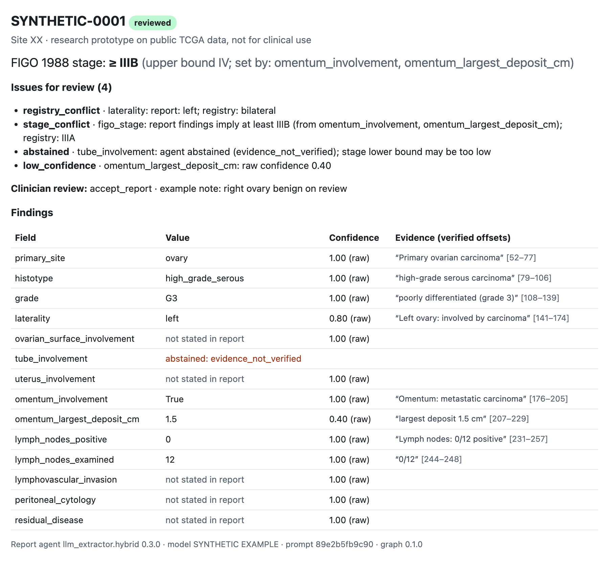

# ovarian-agent-contract

A pathology-report agent for ovarian cancer whose findings carry evidence that code has checked, and a LangGraph
super-agent that sends a case to a clinician when the findings and the registry disagree. It runs on 371 public TCGA-OV
pathology reports from 20 centres, with an evaluation protocol written before the test centres are opened.

> **Status: work in progress (Nov 2026).** The contract, the report agent, the super-agent and the evaluation code
> work and are tested. **There are no evaluation results yet.** The test centres stay locked until the protocol
> ([eval/PROTOCOL.draft.md](eval/PROTOCOL.draft.md)) is frozen. Numbers below are development observations on the
> three development centres only.

## Why I built this
Multi-agent clinical systems pass findings from one agent to the next and finally to a clinician. I wanted to find out
what those messages need to contain before anyone can trust them at another hospital. Here each finding has a status
that separates "the report does not say" from "the agent is not sure", evidence quotes that code checks against the
report, and a confidence score to be calibrated on centres the prompt was not developed on. On the development
centres, 41 of 44 abstentions came from evidence the code could not find in the report.

The decision log ([DECISIONS.md](DECISIONS.md)) records each step: what Claude Code proposed, what I checked, and
what I changed or dropped, including the gold-label pilot I stopped (D29). The
[study guide](https://hamza3e.github.io/ovarian-agent-contract/study-guide.html) is the clinical and ML background I
worked through, step by step, while building it.

## How it works
```
report text ─► report agent (pinned open-weight LLM, run locally)
                 greedy answer + 5 samples, JSON schema enforced by the decoder
             ─► code verifies every evidence quote against the report
             ─► contract output per finding:
                   answered | not_stated | abstained (+ reason)
                   evidence spans with character offsets, raw and calibrated confidence, provenance
             ─► super-agent (LangGraph, deterministic):
                   FIGO 1988 rules ─► registry check ─► uncertainty triage ─┬─► case card (HTML + FHIR)
                                                                           └─► clinician review (interrupt) ─► case card
```

| Design choice | Why |
|---|---|
| `not_stated` and `abstained` are different states | "The report does not say" is an answer; "I am not sure" is a refusal. Mixing them hides failures. |
| The LLM extracts; rules decide the stage | A report can only support a **lower bound** on FIGO stage (stage IV is not in an abdominal pathology report). Rules make that explicit and auditable. |
| Evidence is verified by code, never trusted from the model | An unverified quote makes the hybrid agent abstain instead of answer. |
| Raw and calibrated confidence are separate fields | Downstream code thresholds only the calibrated value, fitted on centres the model was not developed on. |
| Open-weight model, pinned and run locally | Report text never leaves the machine, so the same design can run on site at each hospital. |
| Splits by centre, with a code-enforced test lock | Development on 3 centres, calibration on 3 others, one test run on the remaining 14. |
| Super-agent has no model calls | The same inputs always give the same card; the model's work is already pinned upstream. |

## Components
| Piece | Where | State |
|---|---|---|
| Agent output contract v0.1 (pydantic + JSON Schema) | `src/oac/contract.py`, `contract/` | done |
| Report schema: 14 findings (FIGO stage derived, not extracted) | `src/oac/fields.py` | done |
| Centre-level splits with test lock | `src/oac/splits.py` | done |
| Rules baseline | `src/oac/agents/rules_baseline.py` | done |
| LLM report agent: hybrid and end-to-end modes, vLLM or Claude API backend | `src/oac/agents/llm_extractor.py`, `src/oac/llm/` | done; dev and calibration centres run (prompt v0.3) |
| Evidence verification (fuzzy, multi-part, meaning-word guard) | `src/oac/evidence.py` | done |
| FIGO 1988 lower-bound rules | `src/oac/staging.py` | done |
| Calibrator, metrics (ECE, Brier, risk–coverage, AURC, bootstrap) | `src/oac/calibrate.py`, `src/oac/metrics.py` | code done; calibrator not fitted yet |
| Super-agent v0 (LangGraph) | `src/oac/superagent/` | done on saved outputs |
| Colab runner (resumable, code bundled and pinned) | `notebooks/colab_extract.ipynb`, `src/oac/run_llm.py`, `src/oac/bundle.py` | done |
| Evaluation protocol | `eval/PROTOCOL.draft.md` | draft v0.2; to be frozen before the test run |
| Annotation guide and offline labelling tool | `docs/ANNOTATION_GUIDE.md`, `labeling/` | paused after a pilot (D29) |

## Super-agent v0 (LangGraph)

*Case card for an invented case (no patient data), generated by `python -m oac.superagent.demo`. HTML version: [docs/example_case_card.html](docs/example_case_card.html).*

The report agent extracts; this graph decides what a clinician needs to look at.

- **Stage:** FIGO 1988 lower bound from answered findings, with the findings that set it.
- **Registry check:** answered grade (2-tier compatible), laterality and LVI against the TCGA clinical table, and the
  stage lower bound against the registry stage. A disagreement is a reason to look, not a verdict.
- **Uncertainty triage:** abstentions on findings that move the stage, and answers with low confidence. The card says
  whether confidence is calibrated or raw.
- **Clinician review:** the graph pauses with `interrupt()` and a checkpointer, and resumes with `accept_report`,
  `accept_registry` or `defer` plus a note. The decision is written into the card and its provenance.
- **Outputs:** an HTML card with evidence quotes and offsets, written only to git-ignored `runs/`. Also FHIR R4-shaped
  JSON (DiagnosticReport, Observations, Flags, Provenance) that carries evidence as offsets plus the report hash, never
  text. The JSON has not been validated against a FHIR server.

Synthetic example (invented case and quotes): [docs/example_case_card.html](docs/example_case_card.html),
[docs/example_case_card.fhir.json](docs/example_case_card.fhir.json).

## Development observations (dev centres only, not results)
From the prompt v0.3 hybrid run on the 109 development reports (DECISIONS D25, D28):

| Finding | Answered | Agrees with registry |
|---|---|---|
| Grade (2-tier compatible) | 102 | 91 |
| Laterality | 79 | 71 |
| Lymphovascular invasion | 28 | 28 |

- **Abstentions:** 44 findings, of which 41 had evidence the code could not verify.
- **Super-agent:** 67 of 109 cases have no issues. 42 go to review, mostly for abstentions on omentum (11) or tube (9) involvement, and 8 laterality disagreements with the registry.

These centres were used to develop the prompt, so these numbers say nothing about other hospitals. The test run will.

## What this does not show yet
- No results on unseen centres (pending the frozen protocol and one test run).
- No human gold labels. The registry covers only grade, laterality, LVI and stage, so the other findings have no accuracy
  measurement, and correct `not_stated` answers are not verified (protocol §7).
- Old reports (mostly 1999–2009), FIGO 1988, English only, OCR noise. Research prototype; **not for clinical use.**

## Reproduce
```
uv sync --extra eval --extra agent
uv run python -m oac.fetch        # public data, sha256-checked
uv run pytest -q                  # 86 tests, synthetic fixtures only

# super-agent on saved report-agent outputs
uv run python -m oac.superagent --run runs/<run> --out runs/superagent_dev                 # batch, reviews deferred
uv run python -m oac.superagent --run runs/<run> --out runs/sa --case <id> --interactive   # answer reviews at the terminal
uv run python -m oac.superagent.demo                                                        # regenerate the synthetic example

# report agent on a GPU: writes dist/colab_extract_run.ipynb with the code embedded;
# open it in Colab (or VS Code with the Colab extension) on a GPU runtime
uv run python -m oac.bundle
```

## Data
TCGA-Reports (Kefeli & Tatonetti, *Patterns* 2024; CC BY 4.0) joined with the TCGA-OV clinical table (GDC open access).
Nothing is redistributed here: `oac.fetch` downloads and checks the files. No report text is committed. See
[DATA_CARD.md](DATA_CARD.md).

## How this was built
Built with **Claude Code** as the engineering assistant, under the rules in [CLAUDE.md](CLAUDE.md):
- no test-centre peeking;
- no report text in git;
- no numbers that a script did not produce.

[DECISIONS.md](DECISIONS.md) logs each decision: what the AI proposed, what was checked, and what the author changed or rejected. CI runs lint, tests, a smoke run and a schema check on every push.

Code: MIT ([LICENSE](LICENSE)).
